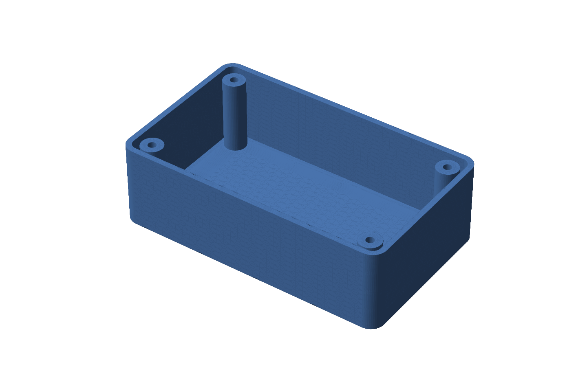

# parametric-enclosure

A small electronics enclosure written as code with [build123d](https://github.com/gumyr/build123d)
on the Open CASCADE kernel, exported to STEP and STL, and checked by a test
suite before anything leaves the repository. The enclosure is ordinary. The
point is the validation.



The model is a filleted box, shelled from the top, with four screw posts in
the corners. Every dimension is a field on a `Params` dataclass. The defaults
rebuild the STEP file I exported in April 2026 exactly, and one of the tests
proves that.

## What the tests check

Numbers below are from a real run on macOS, Python 3.13, build123d 0.10.0,
cadquery-ocp 7.8.1.1.post1, trimesh 5.1.1. `pytest -rA` prints the same lines.

| Check | What it proves | Result from the run |
| --- | --- | --- |
| Analytic volume | Kernel volume equals the closed-form volume derived by hand: box minus shelled cavity plus posts minus holes, with the fillets handled exactly by the (4 - pi) r^2 term. Threshold 0.1 percent. | default 33653.230 mm^3 against 33653.230 mm^3, relative error 2.2e-16. Worst of five parameter sets 1.8e-15. |
| Topology | Face, edge and vertex counts are exactly what the construction predicts, and change by 3, 6 and 4 per post. | default 31 / 72 / 48. One post 22 / 54 / 36. Two posts 25 / 60 / 40. Six posts 37 / 84 / 56. |
| Blind holes | With `hole_blind` the underside of the floor has one wire and no closed circular edges. The same detector finds the holes in the April default. | blind: 1 wire, 0 circles. through: 5 wires, 4 circles of radius 1.5 mm. |
| STL integrity | The mesh is watertight, a single body, consistently wound, and has the Euler characteristic of the solid it came from. Two tolerances, both hole options. | 0.1 mm: 1100 triangles. 0.01 mm: 2188 triangles. All watertight, 1 body. Euler number 2 for blind holes and -6 for through-holes. |
| STL deviation | The largest distance from sampled points on the triangles to the exact B-rep faces is below the requested tolerance. | 0.1 mm: max 0.0314 mm over 5100 points. 0.01 mm: max 0.0050 mm over 6188 points. |
| Revision diff | Symmetric difference between the default STEP and a 1 mm thicker wall equals the analytic expectation, and the default rebuilds the April file. | A minus B 0.000 mm^3. B minus A 13151.327 mm^3. Analytic 13151.327 mm^3. Default against April file 0.000000 mm^3. |

Each test is one short function with a docstring that says what it proves.
The whole suite runs in about four seconds.

## Run it

```
python -m venv .venv
source .venv/bin/activate
pip install -r requirements.txt

pytest

python -m enclosure build --params params/default.json --out out/
python -m enclosure build --params params/blind_holes.json --name blind --out out/
python -m enclosure diff out/enclosure.step original/my_enclosure_v1.step
```

`build` writes a STEP, an STL and a copy of the parameters, then prints the
kernel volume, the analytic volume and the face, edge and vertex counts.
`--stl-tolerance` sets the linear tolerance in millimetres (default 0.1).
`diff` prints the volume of A minus B, B minus A and their sum for two STEP
files.

The picture above comes from `python scripts/render_png.py`, which needs
matplotlib on top of the requirements.

## Parameters

| Field | Default | Meaning |
| --- | --- | --- |
| `L`, `W`, `H` | 100, 60, 30 | outer dimensions in mm |
| `thickness` | 2.0 | wall and floor thickness |
| `fillet_radius` | 5.0 | outer vertical corner radius; the inner radius is this minus the thickness |
| `post_radius` | 4.0 | screw post radius |
| `hole_radius` | 1.5 | screw hole radius (M3 clearance was the intent) |
| `hole_blind` | `false` | `false`: holes run out of the underside, as in April. `true`: holes stop at the top of the floor. |
| `post_seat_depth` | 1.0 | how far each post is sunk into the floor, 0 to `thickness` |
| `post_top_recess` | 1.0 | distance from the open rim down to the post top |
| `post_inset` | 7.5 | distance from the outer wall to a post centre |
| `posts_x`, `posts_y` | 2, 2 | post grid |

`params/` has the default, a blind-hole variant and the thicker wall used by
the revision diff. The reasons behind each option are in
[docs/decisions.md](docs/decisions.md).

## What the tests caught in the April version

The April script is kept untouched in `original/`. It built the right shape,
and the STEP it wrote is the one the defaults reproduce. Writing the tests
turned up two things I had not noticed.

**The holes went through the floor.** The screw hole was a cylinder of
height H centred on the origin, the same centre as the box, so it ran from
the post top out through the underside. Nothing in the code said that and I
had not looked at the bottom. Two tests make it impossible to miss now: the
underside wire count, and the STL Euler characteristic, which is -6 for the
April part because every through-hole is a tunnel from the cavity to the
outside.

**The post seat was an accident of arithmetic.** The post was a cylinder of
height H minus thickness, centred on the origin, which happens to sink it
1 mm into the floor and leave its top 1 mm below the rim. Both numbers only
appeared when I derived the analytic volume by hand and the first attempt did
not match. They are now explicit parameters, `post_seat_depth` and
`post_top_recess`, with the April values as defaults.

One more thing turned up while writing the STL tests, this time in the
tooling rather than the part. build123d's own `export_stl` treats the
tolerance as relative to edge length and reuses any cached mesh, so a 0.1 mm
and a 0.01 mm export produced identical files. The exporter in this repo
calls the Open CASCADE mesher directly with an absolute deflection, which is
why the deviation numbers in the table actually track the requested
tolerance.

## Layout

```
enclosure/      model.py (Params, build_enclosure, analytic_volume)
                export.py (STEP, STL with absolute linear tolerance)
                compare.py (symmetric difference of two STEP files)
                cli.py (python -m enclosure build | diff)
tests/          one file per check, see the table above
params/         default.json, blind_holes.json, thick_wall.json
docs/           decisions.md, enclosure.png
scripts/        render_png.py
original/       the April 2026 script and STEP, unchanged
```

## Continuous integration

`.github/workflows/tests.yml` installs the pinned versions from
`requirements.txt` on Ubuntu and runs `pytest` on every push.
